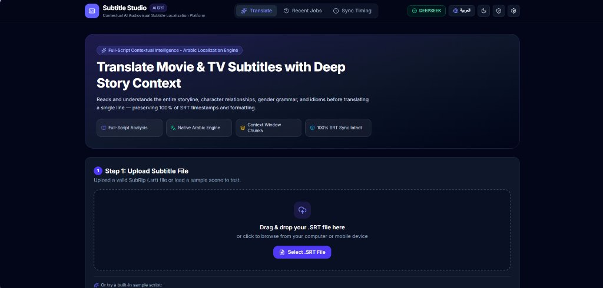

# Subtitle Studio — Advanced AI Subtitle Translation & Synchronization Platform
# استوديو الترجمة — منصة تعريب ومزامنة ملفات الترجمة بالذكاء الاصطناعي

🌐 **Live Web Application / الرابط المباشر للمنصة:** [https://subtitle-studio-xi.vercel.app](https://subtitle-studio-xi.vercel.app)



---

> [!IMPORTANT]
> ### 🔑 Bring Your Own API Key (BYOK) & Privacy Assurance
> To use the online platform, provide your own AI provider API Key (**Google Gemini**, **DeepSeek**, **OpenAI**, or **Anthropic Claude**) via the **AI & Settings** panel.
>
> 🔒 **100% Privacy & Security Guarantee:**
> - Your API key is stored securely in your browser and used strictly to communicate directly with the chosen AI provider.
> - Your keys are **never** logged, exposed to other users, or shared with third parties.
>
> ---
>
> ### 🔒 خصوصية وأمان مفتاح الذكاء الاصطناعي (API Key)
> لتشغيل واستخدام الترجمة على الرابط المباشر، يلزمك استخدام مفتاح API الخاص بك (**Google Gemini** أو **DeepSeek** أو **OpenAI** أو **Anthropic Claude**) عبر نافذة **إعدادات الذكاء الاصطناعي**.
>
> 🛡️ **ضمان السرية والأمان التام:**
> - **مفتاحك آمن 100%:** يُحفظ المفتاح محلياً في متصفحك ويُستخدم حصرياً لإرسال طلبات الترجمة إلى مزود الذكاء الاصطناعي الذي اخترته.
> - **لا يمكن لأحد رؤيته:** لا يظهر المفتاح لأي زائر أو مستخدم آخر، ولا يتم تسجيله على أي خوادم أو مشاركته مع أي طرف ثالث إطلاقاً.

---

## 🌟 Overview / نبذة عن المنصة

**English:**
**Subtitle Studio** is a full-stack, production-grade audiovisual translation, synchronization, and proofreading suite built with **Next.js (App Router), TypeScript, React, and Tailwind CSS**. Designed specifically for cinema and TV series subtitles, it solves the two biggest challenges in movie subtitling:
1. **Contextual Translation Quality:** Understanding the full plot, character relationships, speech registers, and idioms before translating a single line.
2. **Release Synchronization:** Re-timing subtitles that run ahead of or behind the video when moving between different releases (BluRay ⇄ WEB-DL ⇄ HDTV).

**العربية:**
**استوديو الترجمة (Subtitle Studio)** هو تطبيق ويب متكامل ومبني بأحدث تقنيات **Next.js وTypeScript وReact وTailwind CSS** لتعريب وترجمة ومزامنة ملفات ترجمة الأفلام والمسلسلات (`.srt` و `.vtt`) باستخدام نماذج الذكاء الاصطناعي المتقدمة، مع هندسة لغوية مخصصة للترجمة السينمائية وتصحيح التوقيت بين النسخ المختلفة (BluRay ⇄ WEB-DL ⇄ HDTV).

---

## 🚀 Key Features / أبرز الميزات والقدرات

### 1. ⏱️ Subtitle Sync & Release Converter (NEW) / أداة مزامنة التوقيت وتحويل النسخ (جديد)

**English:**
Fixes subtitles where dialogue runs ahead of or behind the video due to different studio intros or different frame rates between releases (e.g. BluRay 23.976 fps vs WEB-DL 24.000 fps vs European TV 25.000 fps). Operates 100% client-side in the browser, keeping all text and formatting tags completely untouched while rewriting only timestamps.

Features **3 practical synchronization modes**:
* **Mode A — Auto Sync by Spoken Lines (Recommended):**
  Play your video, find when 1 or 2 lines are spoken, and enter the times (e.g. `01:14.500` or `74.5`). One line corrects constant intro delays; adding a second line near the end automatically detects and resolves frame-rate drift (FPS drift) across the entire movie.
* **Mode B — Frame Rate & Offset Converter:**
  Directly convert between industry frame rates (`23.976 fps BluRay` ⇄ `24.000 fps WEB-DL` ⇄ `25.000 fps PAL/HDTV`) with instant ±second intro offset buttons.
* **Mode C — Copy Timing from Reference Subtitle:**
  Upload any subtitle file (in any language, e.g. English WEB-DL) that is already in sync with your video. The tool transfers the exact timing to your target subtitle without altering a single translated word. Includes automatic legacy Windows-1256 Arabic encoding recovery.

**العربية:**
حل جذري لمشكلة عدم تطابق الترجمة مع الفيديو الناتجة عن اختلاف طول شارة البداية أو اختلاف سرعة الإطارات بين النسخ (مثل BluRay مقابل WEB-DL). الأداة تعمل بالكامل محلياً داخل المتصفح دون رفع الملفات لأي خادم، وتحافظ على النصوص ووسوم التنسيق 100% مع تعديل التوقيت فقط.

تتضمن **3 أوضاع تشغيل عملية**:
* **الوضع الأول — المزامنة التلقائية بالجمل (الأسهل والأدق):**
  شغّل فيلمك، وابحث عن لحظة سماع سطر أو سطرين واكتب الوقت (مثال: `01:14.500` أو `74.5`). سطر واحد يصلح فارق البداية الثابت؛ وإضافة سطر ثانٍ قرب النهاية يكتشف تلقائياً انحراف سرعة الإطارات (FPS Drift) ويضبط الفيلم كاملاً في ثوانٍ.
* **الوضع الثاني — تحويل معدل الإطارات والإزاحة (Frame Rate & Offset):**
  تحويل مباشر بين سرعات العرض المعروفة (`BluRay 23.976` ⇄ `WEB-DL 24.000` ⇄ `PAL/HDTV 25.000`) مع أزرار سريعة لتقديم وتأخير البداية بالثواني.
* **الوضع الثالث — استنساخ التوقيت من ملف مرجعي (Reference Sync):**
  إذا كان لديك ملف ترجمة بأي لغة أخرى متزامن مع نسختك، ترفع الملفين لتقوم الأداة بنسخ التوقيت المتزامن إلى ملفك العربي فوراً، مع دعم تشفير Windows-1256 للترجمات العربية القديمة.

---

### 2. 🧠 100% Full-Script Contextual Analysis / تحليل سياقي شامل للعمل كاملاً

**English:**
Reads and analyzes the entire subtitle transcript before translation begins through client-orchestrated sequential passes. It extracts:
* **Character Gender & Voice Map:** Exact genders and relationship dynamics (romantic partners, coworkers, rivals) vital for proper grammatical conjugation.
* **Colloquial Idioms, Slang & Double-Entendres:** Prevents literal machine calques and preserves satirical humor, sarcasm, and emotional subtext.
* **Persistent Glossary:** Generates a consistent terminology table for character names, locations, and recurring phrases.

**العربية:**
قراءة وتحليل ملف الترجمة كاملاً قبل بدء الترجمة عبر تمريرات متسلسلة للفيلم، لاستخراج:
* **خريطة الشخصيات وجنس المتحدث والمخاطب:** تحديد دقيق لمن يتحدث ولمن يُوجّه الكلام لضبط التذكير والتأنيث.
* **التعابير الاصطلاحية والنكات والإيحاءات:** منع الترجمة الحرفية الركيكة ونقل المعنى المقصود ونبرة الحوار الأصلية.
* **مسرد موحد دائم (Glossary):** توحيد أسماء الشخصيات والأماكن والمصطلحات طوال الفيلم.

---

### 3. 🎬 Native Arabic Localization Engine / محرك تعريب سينمائي متخصص

**English:**
* Defaults to broadcast-grade **Modern Standard Arabic (الفصحى السينمائية المعاصرة)** with natural dialogue cadence.
* Optional regional dialect registers (**Egyptian, Levantine, Gulf, Moroccan Darija, Iraqi, Tunisian, Sudanese**).
* **Vocative Inversion & Turn-Tracking:** Resolves addressee gender in rapid back-and-forth dialogue (e.g. line addressing Nikki flips the reply addressee to masculine).
* Strict elimination of literal English-to-Arabic calques (`يأخذ مكان`, `يصنع معنى`, `أعدك بشدة`, `إثارة الدراما`, `بهذه الطاقة`).
* Correct handling of food adjectives (`stale` ➔ بايت / غير طازج), adult humor (`rock hard` ➔ منتصباً من فرط الحماس), and emotional vulnerability (`vulnerable` ➔ كشفت عن نفسي / فتحت قلبي).

**العربية:**
* اعتماد الفصحى السينمائية المعاصرة كلغة افتراضية مع صياغة حوارية عفوية وسلسة.
* خيارات للهجات العربية التخصصية (المصرية، الشامية، الخليجية، المغربية، العراقية، التونسية، السودانية).
* **قاعدة عكس المنادى وتتبع أطراف المشهد:** ضبط دقيق لضمائر المتحدث والمخاطب في المشاهد الحوارية السريعة.
* حظر تام للترجمات الحرفية الركيكة (مثل ترجمة "It takes place" إلى "يأخذ مكان").
* صياغة دقيقة للمتلازمات اللفظية والكوميديا والمشاعر الإنسانية.

---

### 4. ✍️ Side-by-Side Subtitle Workspace & AI Proofreading / مساحة عمل تفاعلية وتدقيق لغوي ذكي

**English:**
* Synchronized bilingual grid with search, filtering (All, Needs Attention, Edited, Untranslated), manual editing, and single-line AI regeneration with alternatives.
* **Second-Pass AI Proofreader & Smart Detector:** Audits lines for leftover English words, awkward calques, and pronoun agreement with surrounding dialogue context.
* Simulated 16:9 cinema viewport with reading speed telemetry (Characters Per Second / CPS).

**العربية:**
* جدول تحرير متزامن جنباً إلى جنب يتيح البحث، والفرز، والتعديل اليدوي، وإعادة توليد أي سطر منفرداً مع اقتراح بدائل صياغة.
* **مدقق ذكي من مرحلة ثانية (AI Proofread & Fix):** يرصد الكلمات الأجنبية العالقة، والركاكة اللغوية، وتطابق الضمائر في سياق المشهد ويصححها تلقائياً.
* شاشة محاكاة سينمائية 16:9 مع قياس سرعة القراءة (عدد الأحرف في الثانية).

---

### 5. 🛡️ 100% SRT Integrity & QA Validator / حماية بنية الملفات وجودة التوقيت

**English:**
* Never alters sequence numbers, timestamps, entry counts, or subtitle order.
* Preserves inline formatting tags (`<i>`, `<b>`, `<u>`, `{\an8}`) and musical notes (`♪`).
* Independent 11-point post-translation QA validator ensuring zero missing lines and UTF-8 BOM encoding.

**العربية:**
* مطابقة تامة بنسبة 100% لأرقام المقاطع وتوقيتات البداية والنهاية دون أي تقديم أو تأخير غير مقصود.
* الحفاظ التام على وسوم التنسيق المائلة والغامقة ومحاذاة الشاشة ومقاطع الموسيقى.
* فاحص جودة آلي مكون من 11 معياراً وتصدير ملفات بترميز UTF-8 مع BOM لضمان عملها على جميع الشاشات والمشغلات.

---

## 📂 Project Structure / هيكلية المشروع

```text
subtitle-studio/
├── src/
│   ├── app/                              # Next.js App Router & API routes
│   │   ├── page.tsx                      # Main single-page application orchestrator
│   │   └── api/
│   │       ├── pipeline/                 # Stateless serverless translation endpoints
│   │       │   ├── analyze/route.ts      # Multi-pass full-script context analysis
│   │       │   ├── translate-batch/route.ts # Context-aware batch translation
│   │       │   └── proofread-batch/route.ts # Second-pass batch proofreading
│   │       └── jobs/                     # Single-line regenerate & export routes
│   ├── components/                       # Interactive UI components
│   │   ├── Navbar.tsx                    # Responsive header with theme/lang switchers
│   │   ├── SubtitleSyncTool.tsx          # Subtitle Sync & Release Converter interface
│   │   ├── SubtitleWorkspace.tsx         # Side-by-side editor, filter & proofreader
│   │   ├── SubtitlePreview.tsx           # 16:9 cinema viewport preview & CPS meter
│   │   ├── UploadZone.tsx                # Drag-and-drop subtitle file upload
│   │   └── SettingsModal.tsx             # Client BYOK AI provider configuration
│   ├── lib/
│   │   ├── srt/
│   │   │   ├── sync.ts                   # Linear time transform, FPS & reference sync engine
│   │   │   ├── parser.ts                 # SRT/VTT parser, tag & speaker extractor
│   │   │   └── formatter.ts              # Valid SRT/VTT formatter with BOM
│   │   ├── translation/
│   │   │   ├── arabic-engine.ts          # Arabic rules, gender agreement & calque guard
│   │   │   ├── context-analyzer.ts       # Full-file storyline & glossary analyzer
│   │   │   ├── proofreader.ts            # Second-pass proofreading prompts & pipeline
│   │   │   └── proofread-utils.ts        # Smart error & leftover word detectors
│   │   ├── storage/
│   │   │   ├── client-config.ts          # Encrypted client BYOK credentials storage
│   │   │   └── client-job-store.ts       # LocalStorage job store with checkpoints
│   │   └── ai/
│   │       └── providers.ts              # Gemini, DeepSeek, OpenAI & Anthropic adapters
│   └── types/
│       └── subtitle.ts                   # Core TypeScript type definitions
└── tests/
    └── subtitle-studio.test.ts           # 11 automated test suites covering all workflows
```

---

## 💻 Installation & Local Setup / التثبيت والتشغيل المحلي

### 1. Clone the repository / استنساخ المستودع
```bash
git clone https://github.com/evile92/subtitle-studio.git
cd subtitle-studio
```

### 2. Install dependencies / تثبيت الحزم البرمجية
```bash
npm install
```

### 3. Run the development server / تشغيل خادم التطوير
```bash
npm run dev
```
Open [http://localhost:3000](http://localhost:3000) in your browser.
افتح الرابط [http://localhost:3000](http://localhost:3000) في متصفحك.

### 4. Run automated tests / تشغيل الاختبارات الآلية
```bash
npm test
```

### 5. Production build / بناء نسخة الإنتاج
```bash
npm run build
npm start
```

---

## 🤖 Supported AI Providers / مزودو الذكاء الاصطناعي المدعومون

| Provider / المزود | Recommended Model / النموذج الموصى به | Notes / ملاحظات |
| :--- | :--- | :--- |
| **Google Gemini** | `gemini-2.5-flash` / `gemini-1.5-pro` | Excellent Arabic fluency and large context window |
| **DeepSeek** | `deepseek-chat` (V3) | Outstanding cost-performance and reasoning |
| **OpenAI** | `gpt-4o` / `gpt-4o-mini` | Industry standard translation accuracy |
| **Anthropic** | `claude-3-5-sonnet-latest` | Exceptional literary and dramatic nuance |
| **Custom Endpoint** | Any OpenAI-compatible API | Local Ollama, Groq, OpenRouter, etc. |

---

## 📬 Contact & Support / التواصل والدعم

* **GitHub Repository:** [https://github.com/evile92/subtitle-studio](https://github.com/evile92/subtitle-studio)
* **Email / البريد الإلكتروني:** [stellarspeakapp@gmail.com](mailto:stellarspeakapp@gmail.com)
* **Author:** Subtitle Studio Team
